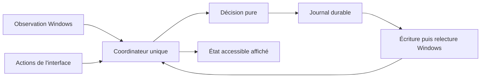

# Implementation Plan: Associer un plan d'alimentation à un logiciel

**Branch**: `main`, premier lot de faisabilité intégré | **Date**: 2026-09-20 | **Spec**: [spec.md](spec.md)

**Input**: `specs/001-app-power-profiles/spec.md`

## Summary

PowerPlanSync applique un plan Windows existant lorsqu'un logiciel configuré fonctionne,
puis revient au plan explicitement choisi. Une interface Rust accessible expose les règles et l'état.
Le premier développement démontre la faisabilité Windows, l'accessibilité et le coût de fonctionnement.
La conception initiale est suivie d'un premier lot de sondes et d'adaptateurs Rust.
Voir les [résultats réels](evidence/prototype-results.md). Le moteur complet reste à construire.

## Technical Context

**Language/Version**: Rust stable, édition 2024, cible `x86_64-pc-windows-msvc`.
Rust 1.98.1 est épinglé dans `rust-toolchain.toml`. Les exemples compilent avec MSVC 14.44.35207
et le SDK Windows 10.0.26100.0. Les versions et preuves sont dans [toolchain.md](evidence/toolchain.md).

**Primary Dependencies**: `windows` pour Win32, `slint` et `slint-build` pour l'interface candidate,
`serde` et `serde_json` pour les fichiers versionnés. Versions et fonctionnalités minimales
épinglées en T001 puis T003. Bibliothèque standard pour le thread de surveillance, les canaux et
les horloges. Aucun runtime asynchrone général ajouté sans besoin mesuré.

**Storage**: `%LOCALAPPDATA%/PowerPlanSync/config.json`, `recovery.json` et journaux bornés.
Dossier alternatif obligatoire pour les essais. Remplacement de fichier et synchronisation
durable dans le même volume. Un seul coordinateur écrit l'état. Aucune base distante.

**Testing**: tests Rust du décideur, erreurs injectées des adaptateurs, essais Windows en compte
standard, Narrateur et inspection de l'arbre accessible, mesures en binaire release.
Les essais qui changent les plans réels sont explicites et sérialisés.

**Target Platform**: Windows 11 x64. Matrice de validation prévue sur 24H2 et le PC local 25H2.
Une seule session interactive active contrôle la machine. ARM64 et Windows 10 hors périmètre.

**Project Type**: application de bureau et de zone de notification, un binaire utilisateur.

**Performance Goals**: activation p95 ≤ 2 s, retour p95 ≤ 5 s avec délai de grâce de 3 s.
Ces délais partent de la création ou de la fermeture réelle, pas du snapshot qui les constate.
T002 mesure la marge restante pour l'appel Windows et sa confirmation. Si la cible échoue,
revoir la détection avant de poursuivre, ou proposer explicitement une modification de la spec.
CPU moyen ≤ 0,1 % total machine et mémoire privée ≤ 40 Mio en arrière-plan.
Mémoire privée ≤ 100 Mio fenêtre ouverte au repos. Méthode dans [quickstart.md](quickstart.md).

**Constraints**: aucune élévation permanente, aucun accès mémoire du jeu, aucun pilote, réseau
ou navigateur embarqué. Aucune création ou modification interne d'un plan Windows.
La protection contre un changement simultané n'est pas atomique.

**Scale/Scope**: validation nominale avec 20 règles et environ 200 processus. Liste de règles,
éditeur d'une règle et réglages généraux. Interface française initiale. Stocker les libellés
dans une ressource pour permettre une traduction ultérieure.

## Constitution Check

| Principe | Avant recherche | Après conception | Preuve ou contrôle prévu |
| --- | --- | --- | --- |
| I. Spécification avant code | Conforme | Conforme | Modèles officiels, spec et tâches traçables, aucune source produit |
| II. Priorité utilisateur | Conforme | Conforme sur conception | Journal, suspension externe et matrice de restauration |
| III. Rust et coût mesuré | Conforme | Conforme sur conception | Rust, Slint candidate, budgets et prototypes bloquants |
| IV. Interface accessible | Conforme | Conforme sur conception | Contrat UI et validation clavier, Narrateur, DPI |
| V. Droits et preuves | Conforme | Conforme sur conception | Compte standard, données isolées, aucune compatibilité jeu annoncée |

Les contrôles de conception passent. Le premier lot vérifie les appels Windows, le témoin,
trois cycles et une partie du parcours graphique. L'accessibilité complète reste ouverte.
Aucune exception constitutionnelle n'est demandée.

## Project Structure

### Documentation (this feature)

```text
specs/001-app-power-profiles/
├── spec.md
├── plan.md
├── research.md
├── data-model.md
├── quickstart.md
├── contracts/
│   ├── user-interface.md
│   └── runtime.md
├── checklists/requirements.md
├── evidence/environment.txt
└── tasks.md
```

### Source Code (repository root)

Structure cible. Les adaptateurs Windows et exemples existent ; les autres modules restent planifiés.

```text
Cargo.toml
Cargo.lock
rust-toolchain.toml
build.rs
src/
├── main.rs
├── lib.rs
├── domain.rs
├── engine.rs
├── coordinator.rs
├── storage.rs
├── diagnostics.rs
├── demo.rs
├── ui.rs
└── windows/
    ├── mod.rs
    ├── power.rs
    ├── processes.rs
    ├── session.rs
    └── startup.rs
ui/
├── main.slint
├── rule-editor.slint
├── tray.slint
└── strings-fr.slint
tests/
├── engine_scenarios.rs
├── recovery_scenarios.rs
├── storage_failures.rs
└── windows_integration.rs
examples/
├── windows_probe.rs
├── ui_probe.rs
└── demo_target.rs
scripts/
├── measure-overhead.ps1
└── verify-windows.ps1
```

**Structure Decision**: un seul package Rust. Le domaine et la décision ne dépendent pas de Slint
ni de Win32. Les effets système passent par les adaptateurs ciblés. Pas de workspace de multiples
crates, de serveur local, de protocole web ni de framework de plugins.

## Phases et conditions de passage

1. **Faisabilité, T001 à T006.** Établir l'environnement Rust et les deux prototypes.
   Windows et UI peuvent être étudiés séparément après l'épinglage des outils.
   T006 consigne les résultats et autorise la suite uniquement si les critères passent.
   Sur demande de l'utilisateur, un exécutable témoin remplace Battlefield dans les essais.
   Aucune compatibilité propre au jeu n'est annoncée. Cela ne bloque pas la livraison générique.
2. **Fondations, T007 à T013.** Modèle, stockage récupérable, contrôle unique, adaptateurs et démonstration.
   Les écritures de plan restent réservées au coordinateur.
3. **US1, T014 à T019.** Premier cycle complet dans l'interface minimale.
4. **US2, T020 à T027.** Changement externe, reprise, crash, batterie et session.
5. **US4, T028 à T034.** Parcours accessible, choix du logiciel et démarrage facultatif.
6. **US3, T035 à T038.** Arbitrage et édition des règles pendant l'exécution.
7. **Validation, T039 à T045.** Ressources, essais d'usage, exécutable témoin, conditionnement et revue finale.

Le premier prototype utile démontre US1. La première version distribuable exige aussi US2, US4,
l'arbitrage déterministe de US3 et les critères transversaux. « MVP » ne dispense pas de restaurer
correctement ou d'être accessible.

## Flux prévu



Le moteur compare la liste ordonnée des règles à un snapshot cohérent. Une observation incertaine
est un état explicite. Les minuteries utilisent une horloge monotone. La source secteur et la
session contrôlée déterminent l'éligibilité. Une seule intention de changement peut être en cours.
Les détails sont dans [data-model.md](data-model.md) et [runtime.md](contracts/runtime.md).

## Complexity Tracking

Aucune violation justifiée à déclarer. Les couches ont chacune une responsabilité testable.
Une architecture différente exige une preuve de besoin dans `research.md` avant la modification.

## Provenance du processus

Le CLI officiel 1.0.8 a initialisé le projet. Les skills installés fournissent les procédures
constitution, specify, plan et tasks. Les résolveurs PowerShell officiels créent les modèles et
valident leurs prérequis. Aucun exécutable `speckit.plan` n'est simulé.
L'état actif est `.specify/feature.json`. Le script peut afficher son identifiant comme
`BRANCH` même si Git est encore sur `main`.
