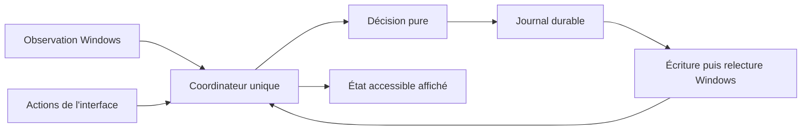

# Implementation Plan: Associer un plan d'alimentation à un logiciel

**Branch**: `main`, premier lot intégré, migration GPUI planifiée | **Date**: 2026-09-20,
mise à jour le 2026-10-25 et le 2026-10-31 | **Spec**: [spec.md](spec.md)

**Input**: `specs/001-app-power-profiles/spec.md`

## Summary

PowerPlanSync applique un plan Windows existant lorsqu'un logiciel configuré fonctionne,
puis revient au plan explicitement choisi. Une interface Rust accessible expose les règles et l'état.
Le premier développement démontre la faisabilité Windows, l'accessibilité et le coût de fonctionnement.
La conception initiale est suivie d'un premier lot de sondes et d'adaptateurs Rust.
Voir les [résultats réels](evidence/prototype-results.md). Une première version Slint a servi
jusqu'à son retrait en T071 ; ses preuves restent dans `evidence/`.

Le 2026-10-25, le responsable produit a validé la migration de l'interface vers GPUI, avec les
maquettes de [design/README.md](design/README.md) et la session de clarification du même jour.
Ce plan remplace la seule couche d'interface. Le moteur, le coordinateur, le stockage, la
récupération, le suivi des processus et les adaptateurs Windows restent en place.
Les décisions sont D12 à D16 dans [research.md](research.md).

Le 2026-10-31, le responsable produit a retenu l'option 1 de D17 : la fenêtre GPUI vit dans un
processus séparé, `power-plan-sync.exe --window`, qui s'arrête à sa fermeture. Le processus de
suivi garde le coordinateur, le contrôle unique, les notifications Windows et l'icône, sans
initialiser GPUI. SC-004 et SC-007 restent inchangés. La conception est D18.

## Technical Context

**Language/Version**: Rust stable, édition 2024, cible `x86_64-pc-windows-msvc`.
Rust 1.98.1 est épinglé dans `rust-toolchain.toml`. Les exemples compilent avec MSVC 14.44.35207
et le SDK Windows 10.0.26100.0. Les versions et preuves sont dans [toolchain.md](evidence/toolchain.md).

**Primary Dependencies**: `windows` 0.62.2 pour Win32, `serde` et `serde_json` pour les fichiers
versionnés. Interface GPUI : `gpui` `=0.3.9` (paquet `gpui-pre`) et `gpui_platform` `=0.3.9`
(paquet `gpui-pre-platform`), `tray-icon` 0.26 sans fonctionnalités par défaut, `image` 0.25
(`ico`, `png`), `futures` 0.3 et `raw-window-handle` 0.6. La fonctionnalité `screenshots` ajoute
`gpui/test-support`, `gpui_platform/test-support` et `gpui_wgpu` `=0.3.9` (paquet `gpui-pre-wgpu`)
sous Linux. Versions reprises de Bientôt (D12), épinglées en T046. `slint` 1.18.0 et `slint-build`
ont été retirés en T071. Bibliothèque standard pour le thread de surveillance, les
canaux et les horloges. L'exécuteur de GPUI sert la seule interface ; aucun runtime asynchrone
général n'est ajouté au moteur.

**Storage**: `%LOCALAPPDATA%/PowerPlanSync/config.json`, `recovery.json` et journaux bornés.
Dossier alternatif obligatoire pour les essais. Remplacement de fichier et synchronisation
durable dans le même volume. Un seul coordinateur écrit l'état. Aucune base distante.

**Testing**: tests Rust du décideur, erreurs injectées des adaptateurs, tests de vues GPUI sans
fenêtre (`HeadlessAppContext`), essais Windows en compte standard, Narrateur et inspection de
l'arbre UI Automation, mesures en binaire release. Les essais qui changent les plans réels sont
explicites, sérialisés et utilisent l'exécutable témoin, jamais Battlefield.
Dans un conteneur Linux, seuls `cargo fmt --check` et
`cargo clippy --locked --all-targets --target x86_64-pc-windows-msvc -- -D warnings` s'exécutent :
le crate dépend de `windows`. Les tests s'exécutent sous Windows, puis dans la CI Windows prévue
(issue #7). Accessibilité, Narrateur, contraste et DPI exigent un vrai Windows.

**Target Platform**: Windows 11 x64. Matrice de validation prévue sur 24H2 et le PC local 25H2.
Une seule session interactive active contrôle la machine. ARM64 et Windows 10 hors périmètre.

**Project Type**: application de bureau et de zone de notification, un binaire utilisateur.
Ce binaire s'exécute en deux processus : le suivi et, tant qu'elle est ouverte, la fenêtre (D18).

**Performance Goals**: activation p95 ≤ 2 s, retour p95 ≤ 5 s avec délai de grâce de 3 s.
Ces délais partent de la création ou de la fermeture réelle, pas du snapshot qui les constate.
T002 mesure la marge restante pour l'appel Windows et sa confirmation. Si la cible échoue,
revoir la détection avant de poursuivre, ou proposer explicitement une modification de la spec.
CPU moyen ≤ 0,1 % total machine et mémoire privée ≤ 40 Mio en arrière-plan.
Mémoire privée ≤ 100 Mio fenêtre ouverte au repos. Fenêtre fermée, la mesure porte sur le
processus de suivi seul ; fenêtre ouverte, sur la somme du processus de suivi et du processus de
fenêtre (D18). Méthode dans [quickstart.md](quickstart.md).

**Constraints**: aucune élévation permanente, aucun accès mémoire du jeu, aucun pilote, réseau
ou navigateur embarqué. Aucune création ou modification interne d'un plan Windows.
La protection contre un changement simultané n'est pas atomique.

**Scale/Scope**: validation nominale avec 20 règles et environ 200 processus. Pages Logiciels,
Réglages et Aide et limites, dialogue d'un logiciel, palette de commandes et menu de l'icône,
selon [user-interface.md](contracts/user-interface.md). Interface française initiale. Les libellés
restent dans une table (`src/interface/strings.rs`) pour permettre une traduction ultérieure.

## Constitution Check

| Principe | Avant recherche | Après conception | Preuve ou contrôle prévu |
| --- | --- | --- | --- |
| I. Spécification avant code | Conforme | Conforme | Modèles officiels, spec et tâches traçables, aucune source produit |
| II. Priorité utilisateur | Conforme | Conforme sur conception | Journal, suspension externe et matrice de restauration |
| III. Rust et coût mesuré | Conforme | Conforme sur conception | Rust et GPUI sans navigateur, budgets mesurés en T048 puis T039 |
| IV. Interface accessible | Conforme | Conforme sur conception | Contrat UI, sonde GPUI T048 avant les fondations, matrice T070 |
| V. Droits et preuves | Conforme | Conforme sur conception | Compte standard, données isolées, aucune compatibilité jeu annoncée |

Les contrôles de conception passent. Le premier lot vérifie les appels Windows, le témoin,
trois cycles et une partie du parcours graphique. L'accessibilité complète reste ouverte.
Pour GPUI, la constitution impose la faisabilité d'accessibilité avant l'interface définitive :
la sonde T047 et sa vérification T048 précèdent les fondations T050 à T057.
Aucune exception constitutionnelle n'est demandée.

Réévaluation après conception GPUI, le 2026-10-25 : les cinq principes restent conformes sur
conception. Le principe III dépend de la mesure T048. Si GPUI dépasse SC-004, le plan s'arrête
et propose un amendement explicite de la spec. Le principe IV dépend des annonces sans
déplacement du focus et des thèmes de contraste, non prouvés par Bientôt (D16).

Mesure T048 du 2026-10-31 (D17) : les annonces et les thèmes de contraste fonctionnent sur
Windows réel, avec les contournements notés en D17. SC-004 est dépassé fenêtre fermée (91,1 Mio
pour 40 Mio). Conformément au paragraphe précédent, ce point s'est arrêté et D17 a proposé deux
issues. Décision du 2026-10-31 : option 1, la fenêtre dans un processus séparé (D18). Le prototype
du processus de suivi sans GPUI occupe 3,6 Mio (T073). Le principe III reste conforme sur
conception ; T081 le vérifie sur le binaire release. Aucune exception constitutionnelle.

## Project Structure

### Documentation (this feature)

```text
specs/001-app-power-profiles/
├── spec.md
├── plan.md
├── research.md
├── data-model.md
├── quickstart.md
├── contracts/
│   ├── user-interface.md
│   ├── runtime.md
│   └── rust-architecture.md
├── design/
│   ├── README.md
│   ├── guide-gpui.md
│   ├── ecrans/
│   └── mouvement/
├── checklists/
├── evidence/
└── tasks.md
```

### Source Code (repository root)

Structure cible après la migration. `src/interface/`, `src/bin/screenshots.rs`,
`examples/gpui_probe.rs`, `assets/` et `tests/presentation.rs` sont planifiés. `src/ui.rs`,
`ui/*.slint`, `build.rs` et les exemples Slint ont disparu en T071.

```text
Cargo.toml
Cargo.lock
rust-toolchain.toml
assets/
├── fonts/            IBM Plex Sans et Mono
└── tray/             icônes bleue, grise, orange et rouge
src/
├── main.rs
├── lib.rs
├── app_args.rs
├── domain.rs
├── engine.rs
├── coordinator.rs
├── storage.rs
├── diagnostics.rs
├── presentation.rs   modèle d'affichage sans type graphique
├── runtime.rs
├── runtime_power.rs
├── tracker.rs        processus de suivi : boucle Win32, icône, hôte du processus de fenêtre
├── window_protocol.rs trames versionnées entre les deux processus
├── window_process.rs processus de fenêtre `--window`
├── bin/
│   └── screenshots.rs
├── interface/
│   ├── mod.rs        application GPUI, globals et raccourcis
│   ├── strings.rs
│   ├── theme.rs
│   ├── motion.rs
│   ├── widgets.rs
│   ├── text_input.rs
│   ├── window.rs     barre de titre, barre latérale et barre d'état
│   ├── tray.rs
│   ├── software_page.rs
│   ├── first_launch.rs
│   ├── rule_dialog.rs
│   ├── messages.rs
│   ├── settings_page.rs
│   ├── help_page.rs
│   └── palette.rs
└── windows/
    ├── mod.rs
    ├── file_dialog.rs
    ├── notifications.rs
    ├── power.rs
    ├── preferences.rs
    ├── processes.rs
    ├── session.rs
    ├── startup.rs
    └── window_channel.rs canaux nommés du processus de fenêtre
tests/
├── engine_scenarios.rs
├── presentation.rs
├── recovery_scenarios.rs
├── storage_failures.rs
└── windows_integration.rs
examples/
├── windows_probe.rs
├── gpui_probe.rs
└── demo_target.rs
scripts/
├── measure-overhead.ps1
├── measure-window-reopen.ps1
├── verify-window-lifecycle.ps1
└── verify-windows.ps1
```

**Structure Decision**: un seul package Rust. Le domaine et la décision ne dépendent pas de GPUI
ni de Win32. `src/presentation.rs` produit un modèle d'affichage sans type graphique, testable
sans fenêtre. Seul `src/interface/` dépend de GPUI. Le module ne s'appelle pas `gpui` pour ne pas
masquer la dépendance. Seul `src/window_process.rs` l'exécute ; le processus de suivi n'utilise de
`src/interface/` que `tray.rs`, sans GPUI. Les effets système passent par les adaptateurs ciblés.
Pas de workspace de multiples crates, de serveur local, de protocole web ni de framework de
plugins. Le protocole entre les deux processus reste privé : deux canaux nommés hérités par le
seul processus de fenêtre (D18).

## Phases et conditions de passage

1. **Faisabilité, T001 à T006.** Établir l'environnement Rust et les deux prototypes.
   Windows et UI peuvent être étudiés séparément après l'épinglage des outils.
   T006 consigne les résultats. Les preuves Windows autorisent les fondations et le moteur
   indépendants de l'UI. T004 et T006 restaient ouvertes jusqu'à la conclusion d'accessibilité.
   Avec la décision GPUI, T048 et T049 les remplacent. Voir D11 et D12 dans `research.md`.
   Sur demande de l'utilisateur, un exécutable témoin remplace Battlefield dans les essais.
   Aucune compatibilité propre au jeu n'est annoncée. Cela ne bloque pas la livraison générique.
2. **Fondations, T007 à T013.** Modèle, stockage récupérable, contrôle unique, adaptateurs et démonstration.
   Les écritures de plan restent réservées au coordinateur.
   Les contrats et tests de récupération de T020/T021 peuvent accompagner le coordinateur
   avant son branchement graphique, car ils définissent les mêmes transactions durables.
3. **US1, T014 à T019.** Premier cycle complet dans l'interface minimale.
4. **US2, T020 à T027.** Changement externe, reprise, crash, batterie et session.
5. **US4, T028 à T034.** Parcours accessible, choix du logiciel et démarrage facultatif.
6. **US3, T035 à T038.** Arbitrage et édition des règles pendant l'exécution.
7. **Faisabilité GPUI, T046 à T049.** Épingler GPUI, construire la sonde, la vérifier sur
   Windows et conclure. Remplace T003, T004 et T006 pour l'interface. Ces tâches précèdent
   toute interface GPUI définitive, comme l'exige la constitution.
8. **Fondations GPUI, T050 à T057.** Modèle d'affichage neutre, thème, mouvement, composants,
   fenêtre, icône, branchement sur le coordinateur et captures hors écran. L'interface GPUI
   s'ouvre avec l'option de développement `--gpui` ; l'application Slint reste le défaut jusqu'à T071.
9. **US1 en GPUI, T058 à T060.** Page Logiciels, dialogue d'un logiciel et « Pour commencer ».
10. **US2 en GPUI, T061 à T063.** Relecture des réglages, messages intégrés, pause et sortie.
11. **US3 en GPUI, T064.** Suivre, réordonner, modifier et retirer avec annulation.
12. **US4 en GPUI, T065 à T070.** Réglages, aide, palette, accessibilité, thèmes, mouvement et
    vérification Windows complète. US3 passe avant US4 dans cette vague, car T069 et T070
    vérifient aussi l'échange de lignes de T064.
13. **Fenêtre dans un processus séparé, T073 à T081.** Mesure du processus de suivi sans GPUI,
    protocole et canaux, processus de fenêtre, processus de suivi sans GPUI, réouverture, fenêtre
    perdue ou sans réponse, dialogues et démonstration, puis vérification Windows. `--gpui` passe
    au processus de suivi avec T077. T071 attend T081.
14. **Retrait de Slint, T071 et T072.** GPUI devient l'interface par défaut, Slint et `--gpui`
    disparaissent. Le responsable produit a décidé le 2026-11-01 de retirer Slint avant T070,
    qui vérifie le binaire sans Slint. Le guide GPUI remplace `docs/guide-utilisateur.md` à la livraison.
15. **Validation, T039 à T045.** Ressources, essais d'usage, exécutable témoin, conditionnement et
    revue finale, sur le binaire GPUI.

Les tâches Slint terminées restent cochées comme historique et portent la mention de leur
remplacement dans [tasks.md](tasks.md). Les tâches non UI terminées restent valables.

Le premier prototype utile démontre US1. La première version distribuable exige aussi US2, US4,
l'arbitrage déterministe de US3 et les critères transversaux. « MVP » ne dispense pas de restaurer
correctement ou d'être accessible.

## Flux prévu



Le moteur compare la liste ordonnée des règles à un snapshot cohérent. Une observation incertaine
est un état explicite. Les minuteries utilisent une horloge monotone. La source secteur et la
session contrôlée déterminent l'éligibilité. Une seule intention de changement peut être en cours.
Les détails sont dans [data-model.md](data-model.md) et [runtime.md](contracts/runtime.md).

## Complexity Tracking

Aucune violation constitutionnelle. Les couches ont chacune une responsabilité testable.
Une architecture différente exige une preuve de besoin dans `research.md` avant la modification.

| Complexité temporaire | Pourquoi | Alternative plus simple rejetée |
| --- | --- | --- |
| Deux processus du même exécutable et un protocole privé (D18) | GPUI occupe 59,7 Mio sans fenêtre : SC-004 fenêtre fermée exige qu'il ne tourne pas dans le processus de suivi | Amender SC-004 à 100 Mio : rejeté par le responsable produit le 2026-10-31 (D17) |

## Provenance du processus

Le CLI officiel 1.0.8 a initialisé le projet, mis à jour en 1.1.3 le 2026-10-11. Les skills installés fournissent les procédures
constitution, specify, plan et tasks. Les résolveurs PowerShell officiels créent les modèles et
valident leurs prérequis. Aucun exécutable `speckit.plan` n'est simulé.
L'état actif est `.specify/feature.json`. Ce fichier est local et ignoré par Git. Le script peut
afficher son identifiant comme `BRANCH` même si Git est encore sur `main`.
La mise à jour GPUI du 2026-10-25 a suivi `speckit-plan`, `speckit-tasks` puis une passe
`speckit-analyze`, à la main : les scripts PowerShell ne s'exécutent pas dans le conteneur Linux
utilisé et `.specify/feature.json` y était absent.
La mise à jour du 2026-10-31 (D18) a exécuté `setup-plan.ps1 -Json` et `check-prerequisites.ps1`
sous Windows ; le plan existant est conservé et complété à la main, de même que les tâches. Une
passe `speckit-analyze` indépendante a suivi : 17 constats, aucun critique. Ses constats sur le
passage des handles, la vue « Contrôle indisponible », la règle d'arrêt fenêtre ouverte, la file
de commandes, la perte visible, les dépendances et les déductions présentées comme des mesures
sont repris dans D18, `contracts/runtime.md` et ce fichier.
